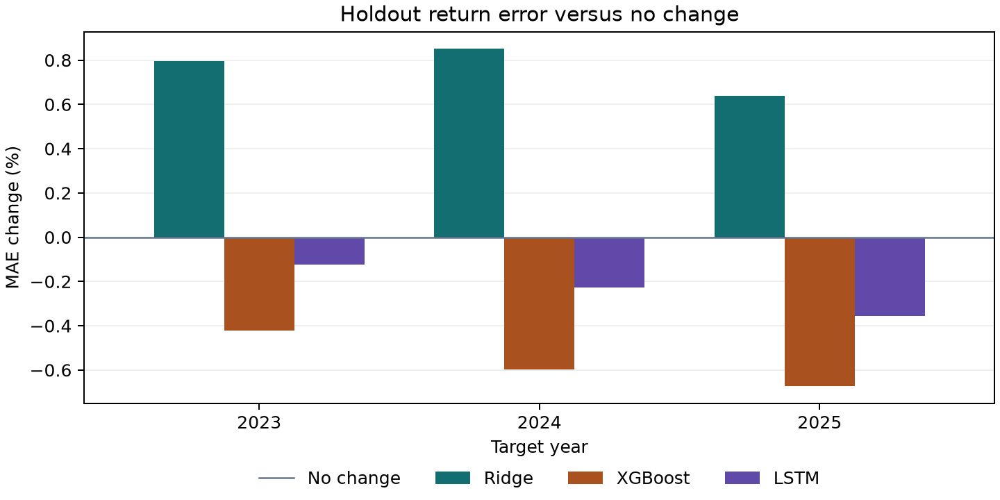
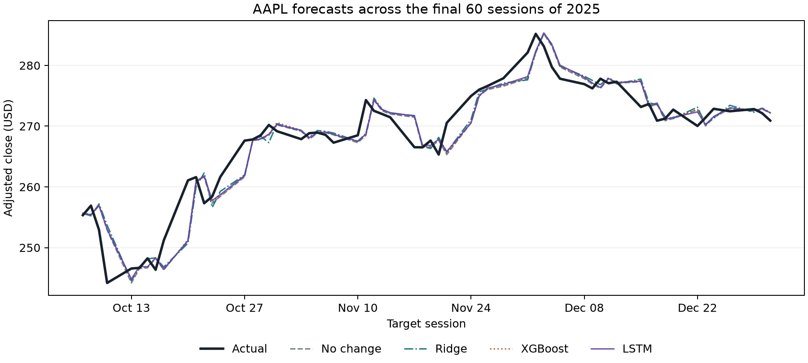

# Next-session stock price forecasting

Can a model improve on carrying today's adjusted closing price forward? The [forecasting notebook](stock_forecasting.ipynb) compares Ridge regression, XGBoost, and a PyTorch LSTM for AAPL, JPM, JNJ, WMT, and XOM. The learned models use the last 20 trading sessions to forecast the next session's return and convert it to an adjusted closing price.

## Findings

Settings were selected on the 2020–2022 validation years. Each model was then refit through 2022 and scored on the same **3,760 stock-date pairs** in the 2023–2025 final test. Lower mean absolute return error (MAE) is better.

| Method | Final-test MAE (basis points) | Change vs. no change |
|---|---:|---:|
| **XGBoost** | **95.56** | **−0.57%** |
| LSTM | 95.88 | −0.24% |
| Ridge regression | 96.84 | +0.75% |
| No change | 96.11 | Baseline |

XGBoost had the lowest final-test error in each year, with a small overall lead of **0.55 basis points** over no change. The no-change rule led on average during validation. On the final test, XGBoost predicted the direction correctly 54.29% of the time, compared with 54.48% for always predicting up. [Overall metrics](outputs/metrics_overall.csv) · [By stock](outputs/metrics_by_stock.csv) · [By year](outputs/metrics_by_year.csv)



Bars below zero indicate lower error than the no-change benchmark for that year.



The AAPL price chart shows how closely the learned forecasts follow the no-change forecast. The yearly error chart makes the small differences between methods easier to see.

The validation charts show the three yearly scores and the average that determined the best tested setting within each model. [XGBoost settings](outputs/validation_xgboost_settings.png) · [Ridge settings](outputs/validation_ridge_settings.png) · [LSTM settings](outputs/validation_lstm_settings.png)

## Reproduce the experiment

Create the pinned Conda environment from the repository root, open the notebook, and run all cells.

```sh
conda env create --file environment.yml
conda activate stock-predictor
jupyter lab stock_forecasting.ipynb
```

For an existing workspace environment at `.conda`, use `conda activate "$PWD/.conda"`. To run without opening JupyterLab, use `python -m nbconvert --to notebook --execute --inplace --ExecutePreprocessor.timeout=900 stock_forecasting.ipynb`.

Edit `MODEL_SETTINGS` in [forecasting.py](forecasting.py) to try new values. Set `STOCK_FORECAST_OUTPUT` to a separate directory to keep earlier exports available. To regenerate the validation charts, run `python plot_validation_settings.py --by-model` or supply the path to a trial's `validation_scores.csv`.

## Data and outputs

The [Yahoo Finance snapshot](data/yahoo_2010_2025.csv) covers January 2010 through December 2025. It was assembled from the full-precision daily data embedded in Yahoo Finance's public history pages after its chart API rate-limited the download. The prices are adjusted for splits and dividends. When the cache is absent, the downloader tries `yfinance` first.

- [Holdout predictions](outputs/holdout_predictions.csv) contains the individual forecasts and observed outcomes.
- [Validation scores](outputs/validation_scores.csv) records the error for each setting in each validation year.
- [Next-session example](outputs/next_forecast.csv) uses the final observation in the snapshot to demonstrate one additional forecast.
- [Experiment configuration](outputs/experiment.json) records the data source, snapshot hash, software versions, seed, and selected settings.
